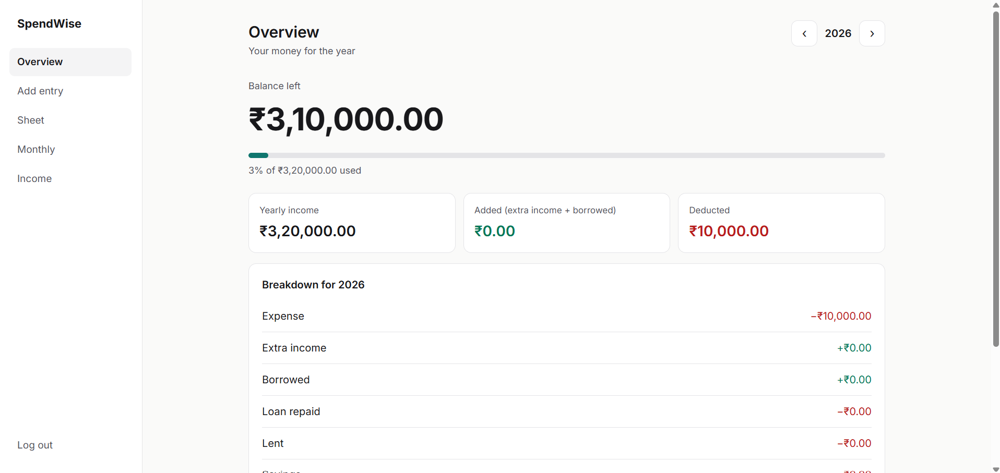
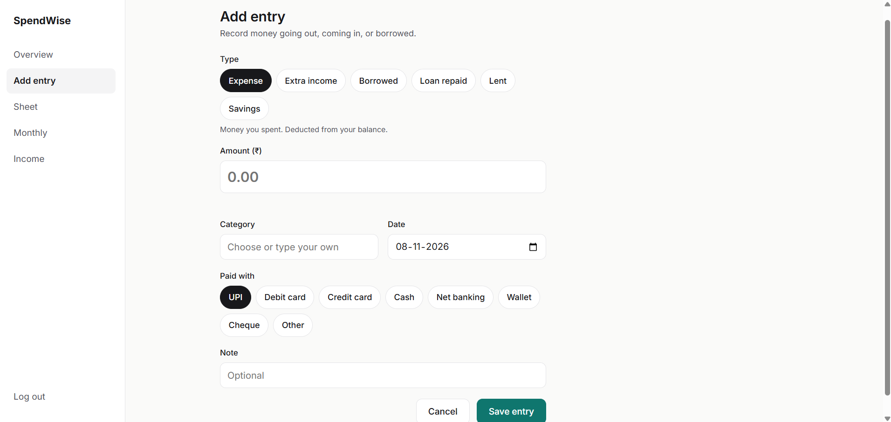
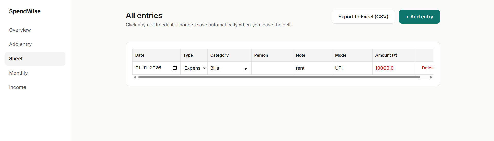
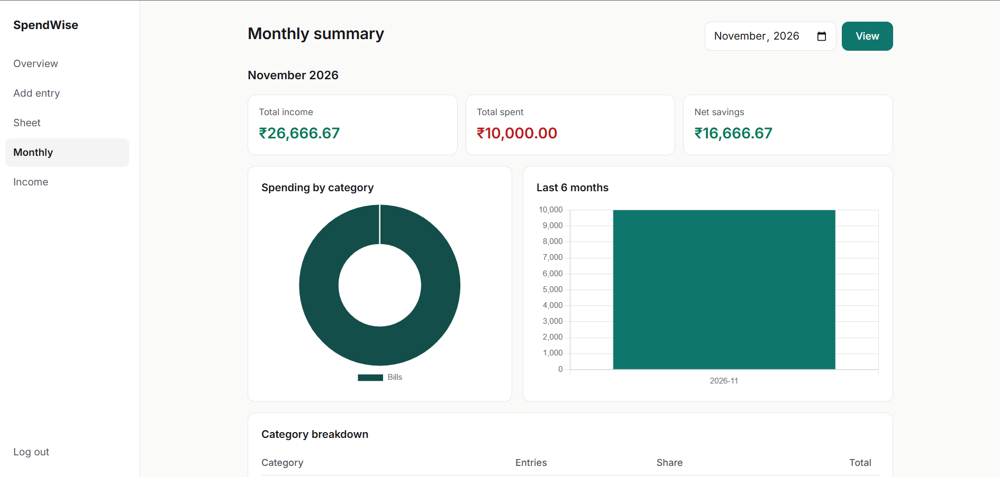
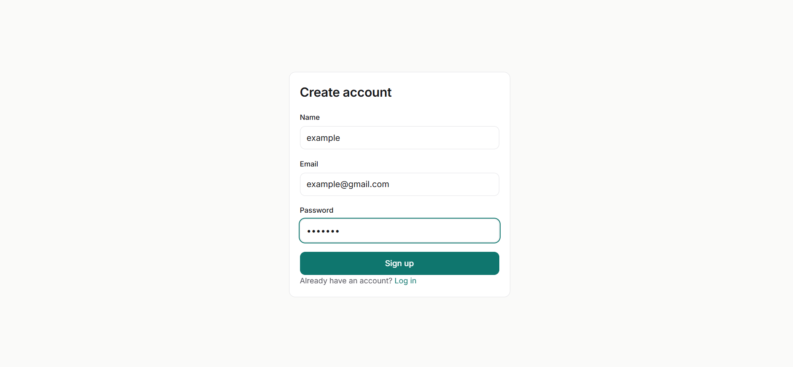

# expense-tracker
Personal finance tracker built with Flask, SQLite and JavaScript.
# SpendWise – Expense Tracker

A responsive personal finance web app built with Flask and SQLite.
Set your yearly income, add entries, and see what's left.

## Features
- Register and log in (hashed passwords)
- Yearly income plans that can change during the year (raise or new job)
- Six entry types: expense, extra income, borrowed, loan repaid, lent, savings
- Payment modes and custom categories
- Overview page with yearly balance and progress bar
- Editable spreadsheet-style table with auto-save
- Monthly summary with category breakdown and charts
- Export to Excel (CSV)
- Responsive, minimal design for desktop and mobile

## Tech stack
Python, Flask, SQLite, HTML, CSS, JavaScript, Chart.js

## Screenshots






## Run locally
```bash
python -m venv venv
venv\Scripts\activate
pip install flask
python app.py
```
Then open http://127.0.0.1:5000

## Planned
- Offline-first mobile version (PWA)
